# SceneForge AI
**Live demo:** https://sceneforge-q5ib.onrender.com

**Describe a scene in plain words. Get a blocked, shot-listed 3D previs, performed by real motion-capture data.**

> "Two fighters circle each other. One lunges with a punch, the other dodges and falls. Slow push-in on the winner."

SceneForge turns that sentence into a playable animated scene in about 20 ms: two actors performing real CMU mocap clips, staged so the punch actually lands, cut together by a virtual cinematographer, with a shot list you can export.


Previsualization ("previs") is how film, game and animation teams plan action before an expensive shoot. Today it means an artist hand-blocking proxy characters for days. SceneForge is a multi-agent system that does a first pass from a paragraph of text, so directors can iterate on staging and coverage in seconds.

---

## What it does

- **Natural-language direction.** Type or dictate (English, Hindi or Telugu via the Web Speech API) who is in the scene, what they do, and optionally how to shoot it.
- **Real motion, not generated motion.** Every action is grounded in one of 73 curated clips (72 real CMU captures plus a keyframed pushup, clearly labelled) from the CMU Graphics Lab Motion Capture Database, with root motion preserved, so walks travel and falls land on the floor.
- **Everyday life, not just action.** Eating (dinner, soup, a sandwich), cooking (chopping, slicing, mixing, kneading, making tea or coffee), setting the table, phone calls, typing and more, with tables, counters, plates and bowls placed automatically under the actor's hands.
- **Exercise.** Jumping jacks, squats, weight lifting, stretching and pushups. CMU has no floor pushups, so `tools/synth_motion.py` keyframes one on the CMU skeleton's own bone lengths (two-bone arm IK, planted hands, straight plank).
- **Honest about gaps.** An action no clip can perform is reported ("Not in the motion library yet: …") instead of being replaced by something wrong.
- **Physical staging.** Characters are blocked on a 10 x 10 m capture volume. Approaches stop at the right distance, reactions overlap the attack that caused them, and fallen characters stay down.
- **A virtual cinematographer.** 9 shot types (wide, medium, close-up, two-shot, over-the-shoulder, low/high angle, tracking, POV), 6 camera moves, real lens focal lengths, the 180-degree rule and occlusion-aware framing.
- **Explainable agents.** The UI shows each agent's decisions, retrieval confidence and every automatic fix.
- **Exports.** Scene plan (JSON), shot list (CSV) and a rendered video of the director's cut (WebM).

## Architecture

```mermaid
flowchart LR
    P[Scene description] --> D[Director agent<br/>Claude / Gemini / GPT<br/>or rule-based fallback]
    D -->|ScenePlan JSON<br/>validated + repaired| R[Motion Retriever<br/>BM25 + phrase + id signals<br/>over 73 motion clips]
    R --> C[Continuity agent<br/>references, overlaps,<br/>idle and hold fill]
    C --> B[Blocking agent<br/>root-motion integration,<br/>reach checks, approaches]
    B --> K[Cinematographer<br/>coverage, 180-degree rule,<br/>notes follow their beats]
    K --> S[Resolved scene + trace]
    S --> V[Three.js viewer<br/>playback, camera, timeline,<br/>video export]
```



| Agent | Responsibility | Example decision from the trace |
|---|---|---|
| Director | Prompt to structured `ScenePlan` (pydantic schema). LLM output is validated; validation errors are sent back for up to 2 repair attempts; any failure falls back to the rule-based planner. | `anthropic/claude-sonnet-5-5 planned 5 beats, 3 shots in 1 attempt` |
| Motion Retriever | Grounds each beat in a real clip. Verifies LLM-chosen clip ids and reports confidence and alternatives. | `the other dodges -> duck (0.98)` |
| Continuity | Fixes unknown character references, removes self-overlaps, fills gaps with idles, holds the final pose after falls and sits. | `idle/hold fill for 2 gaps` |
| Blocking | Integrates each clip's root motion to place actors. Detects interactions that are out of reach and inserts an approach, shifting the exchange (and the partner's reaction) later. | `A was 8.2 m from B for 'punch' (reach 1.1 m): inserted 1.8 s run approach` |
| Cinematographer | Turns director notes into shots anchored to beats (so they move when blocking retimes), and designs coverage where there are no notes. | `designed 3 shots of coverage for 0-9.1 s` |

The Python sampler (`library.sample_root`) and the JavaScript sampler (`frontend/motion.js`) implement the same looping root-motion maths, so what the agents plan is exactly what renders.

## Evaluation

`python evals/run_evals.py` runs two benchmarks. Results for the rule-based planner (no API key):

| Benchmark | Metric | Result |
|---|---|---|
| Motion retrieval (89 action phrases) | Top-1 / Top-3 / MRR | **0.99 / 1.00 / 0.99** |
| Scene direction (26 scenes) | Valid plan rate | **1.00** |
| | Cast accuracy | **1.00** |
| | Action recall | **0.98** |
| | Camera-note recall | **1.00** |
| | Contact accuracy (interactions start within reach) | **1.00** |
| | Shot coverage (contiguous, no gaps) | **1.00** |
| | Actor collision rate | 0.012 |
| | Latency p50 | 5.0 ms |

Run `python evals/run_evals.py --provider anthropic` (or `gemini`, `openai`) with a key set to compare an LLM Director against this baseline; results land in `evals/results/`.

## Engineering notes

A few problems that were only found by measuring:

- **Half the dataset played at double speed.** The BVH release stamps every file at 120 fps, but subjects 141 and 143 were captured at 60 fps. Their "walk" measured 2.6 m/s with a 1.6 Hz stride, which is a jog. Gait-frequency analysis confirmed the true rate; `tools/build_motion_library.py` now corrects it per subject.
- **Loopable locomotion.** Walk cycles are cut by searching every window for maximum straight-line travel, minimum heading change and minimum start/end pose mismatch, so a 2-second walk can loop for 10 seconds without popping.
- **Fights that never connected.** After "circling", fighters ended up 8 m apart and punched air. The Blocking agent now checks per-clip reach and inserts an approach, moving the partner's reaction with it. Contact accuracy went from failing to 100% on the eval set.
- **Camera notes drifting off their moment.** "Slow push-in on the winner" was anchored to a time that blocking later shifted. Shots now follow the beat they were attached to.

## Run it

```bash
# Option 1: zero dependencies beyond pydantic (stdlib server)
pip install pydantic
python devserver.py            # http://127.0.0.1:8000

# Option 2: production server
pip install -r requirements.txt
uvicorn app:app --port 8000

# Option 3: Docker
docker build -t sceneforge . && docker run -p 8000:8000 --env-file .env sceneforge
```

### Go live (free) on Render

1. Push this folder to a GitHub repository.
2. On [render.com](https://render.com), choose **New > Blueprint** and pick the repository. `render.yaml` sets everything up (Python, `pip install pydantic`, `python devserver.py`, health check).
3. Open the `onrender.com` link Render gives you. Free services sleep after 15 minutes idle and take about a minute to wake.

The public server allows 20 scenes per visitor per minute (`SCENEFORGE_RATE_LIMIT`). If you add an LLM API key on a public deployment, also set a spending limit with that provider.

Set `ANTHROPIC_API_KEY`, `GEMINI_API_KEY` or `OPENAI_API_KEY` (see `.env.example`) to use an LLM Director. Without a key the rule-based planner runs, so the demo always works. Hindi and Telugu prompts need an LLM.

```bash
python -m unittest discover tests      # 21 tests, includes a mocked LLM repair loop
python evals/run_evals.py              # benchmarks
```

### Rebuild the motion library (optional)

The processed library is committed in `data/`. To rebuild from the raw BVH files:

```bash
git clone --depth 1 --filter=blob:none --sparse https://github.com/una-dinosauria/cmu-mocap
pip install numpy
python tools/build_motion_library.py --bvh-root cmu-mocap/data
```

Clips, tags and trims live in `data/clip_catalog.tsv`; add a row to add a motion.

### Add a new kind of scene

1. Find takes in the CMU index (`cmu-mocap-index-text.txt`), for example `79_12 eating dinner`.
2. Add a row to `data/clip_catalog.tsv`: `id, cmu take, category, comma-separated tags, description, optional trim`.
3. Rebuild the library (above). The build prints each clip's duration, travel and head height so you can spot bad takes.
4. Optional: give it furniture or hand props in `frontend/props.js` (`PROP_SPECS`), and synonyms in `sceneforge/library.py`.
5. Add a phrase to `evals/retrieval_cases.tsv` and run the evals to check the new motion is found.

## API

| Method | Path | Description |
|---|---|---|
| `POST` | `/api/direct` | `{"prompt": "...", "provider": "auto"}` returns `{scene, trace, total_ms, provider}` |
| `GET` | `/api/library` | Clip catalog, skeleton joints and bones |
| `GET` | `/api/providers` | Which planners are available on this server |
| `GET` | `/motions/{clip}.json` | Joint positions for one clip (30 fps, millimetres) |

## Project layout

```
sceneforge/    agents: director.py, planner_offline.py, llm.py, library.py, schema.py, api.py
frontend/      Three.js viewer: app.js, motion.js (playback), camera.js (cinematographer), props.js (set dressing)
tools/         build_motion_library.py (BVH parsing, FK, fps correction, loop windows)
data/          clip_catalog.tsv + processed motion library
evals/         retrieval_cases.tsv, scenes.jsonl, run_evals.py, results/
tests/         unit tests
```

## Limitations and roadmap

- Motions come from a fixed library; blending is a 0.28 s crossfade, so some transitions slide. Next: foot-locking IK and motion matching between clips.
- Mannequins are procedural proxies. Next: FBX/glTF export of the blocked scene so it opens in Maya, Blender or MotionBuilder.
- The rule-based planner handles English only. LLM planners handle other languages.
- Next: a Blender MCP server so an agent can apply the plan to a real rig; text-to-motion generation for actions outside the library.

## Credits

- Motion data: [CMU Graphics Lab Motion Capture Database](http://mocap.cs.cmu.edu), BVH conversion by Bruce Hahne. Check CMU's usage terms before redistributing the raw data.
- Rendering: [three.js](https://threejs.org) (MIT), vendored in `frontend/vendor`.

Built by [Pranay Sai Vanam](https://linkedin.com/in/pranay-sai-vanam).
